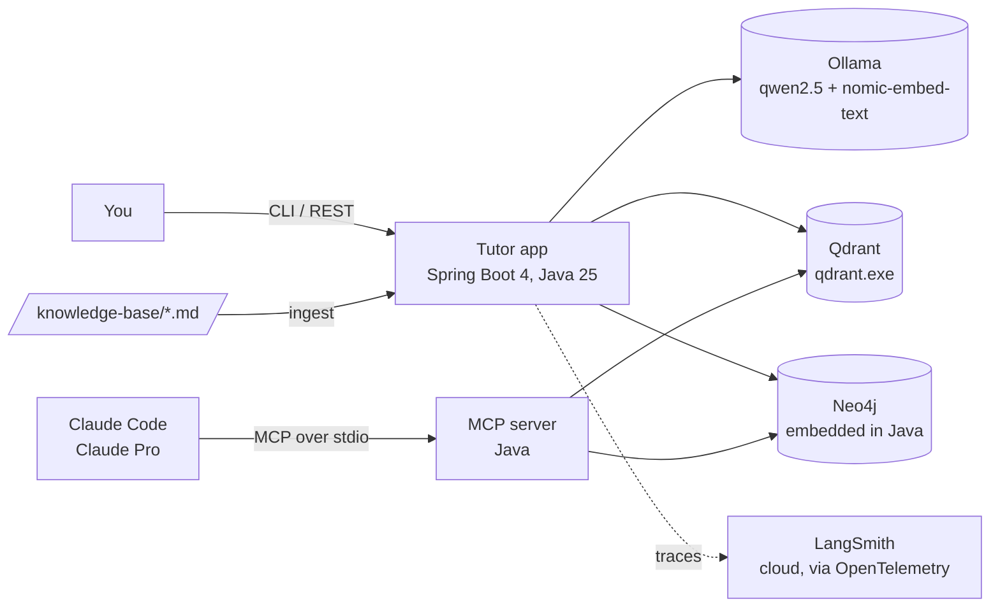
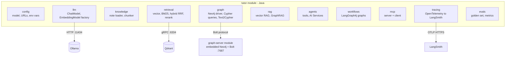
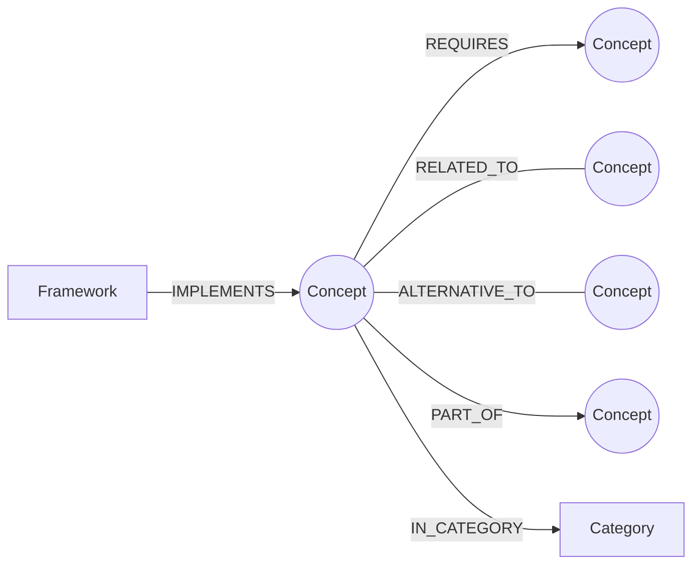
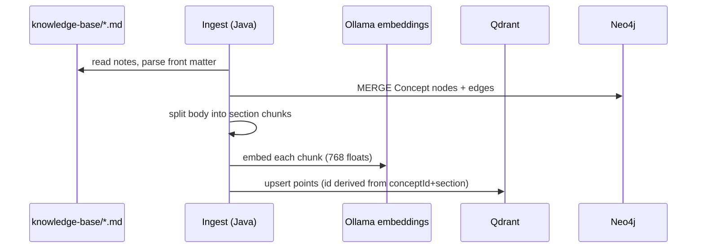
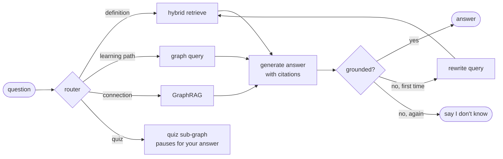
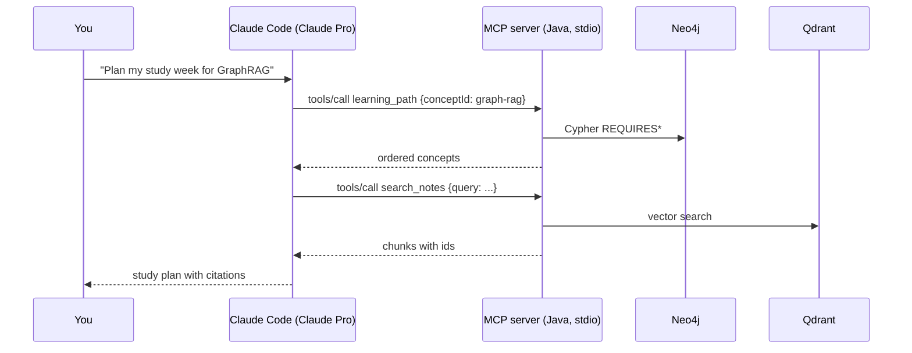

# Architecture: ConceptGraph (AI Concepts Tutor)

This is the target design. Each POC builds one slice of it (see [roadmap.md](roadmap.md)).

## 1. Problem and users

**User:** an engineer learning AI (you). **Problem:** AI concepts are many and tangled. Reading
about "GraphRAG" makes little sense before "embeddings", "RAG" and "knowledge graph".
A good tutor answers *with sources*, knows *the order to learn things in*, and *checks understanding*.

**What the system does**

| Capability | Example question | Main technique |
|-----------|------------------|----------------|
| Explain | "What is chunking?" | RAG over notes (vector DB) |
| Compare | "RAG vs fine-tuning?" | Hybrid retrieval + graph `ALTERNATIVE_TO` edges |
| Learning path | "What before LangGraph?" | Graph traversal (`REQUIRES*`) |
| Connect | "How does MCP relate to tool calling?" | GraphRAG (graph facts + text) |
| Ad-hoc graph question | "Which concepts have no prerequisites?" | Text-to-Cypher (guarded) |
| Quiz | "Quiz me on embeddings" | LangGraph4j workflow with human-in-the-loop |
| Use from Claude | "Plan my study week" in Claude Code | MCP server exposing tools |

## 2. Architecture rules (never violate)

1. **Ground every answer.** Answers come from retrieved notes or graph facts and cite them
   (`[concept-id]`). If nothing relevant is found, say so instead of guessing.
2. **The graph decides structure, the LLM explains it.** Learning paths and prerequisites are
   computed by Cypher queries, never invented by the model.
3. **Every LLM call is traceable.** Model, prompt version, inputs, outputs, tokens and latency are
   recorded as a trace (LangSmith, or a local file when offline).
4. **Read-only by default.** Model-generated Cypher runs only after a code check rejects writes
   (`CREATE`, `MERGE`, `DELETE`, `SET`, ...). MCP tools are read-only.
5. **Provider-agnostic.** Code depends on LangChain4j interfaces (`ChatModel`, `EmbeddingModel`),
   never on Ollama directly, so moving to a hosted model is a config change.

## 3. System context



Two "brains" use the same knowledge:

- **Your own agents** (LangChain4j / LangGraph4j) run on a **local model** through Ollama.
- **Claude** (through Claude Code, your Pro plan) uses the **same tools over MCP**. The MCP server
  returns facts and text only; Claude does the reasoning. This is how you use Claude without an API key.

## 4. Components



| Component | Responsibility | Tech |
|-----------|---------------|------|
| `graph-server` | Runs Neo4j **inside a Java process** and opens the Bolt port, so it behaves like a real Neo4j server. A separate module avoids library clashes. | `org.neo4j:neo4j` 5.26 LTS (embedded) |
| `knowledge` | Reads markdown notes and their front matter; splits them into chunks by section | Plain Java |
| `retrieval` | Vector search (Qdrant), keyword search (BM25 written in Java), fusion (RRF), optional LLM reranking | LangChain4j Qdrant store |
| `graph` | Builds the concept graph; prerequisite paths; neighbours; guarded Text-to-Cypher | Neo4j Java driver |
| `rag` | Assembles context and prompts; enforces citations | LangChain4j |
| `agents` | Tool-calling agent: the model chooses which tool to call | LangChain4j AI Services, `@Tool` |
| `workflows` | Explicit state machines: router, corrective RAG, quiz with pause, supervisor | LangGraph4j |
| `mcp` | Server: exposes tools/resources/prompts to Claude Code. Client: lets our agent use any MCP server | MCP Java SDK, LangChain4j MCP |
| `tracing` | A LangChain4j `ChatModelListener` plus workflow spans, exported as OpenTelemetry | OpenTelemetry SDK |
| `evals` | Golden questions; retrieval hit@k; answer grading | Plain Java |

## 5. Data model

### 5.1 Knowledge base (source of truth)

`knowledge-base/concepts/<id>.md`, one note per concept (about 25 notes):

```markdown
---
id: graph-rag
title: GraphRAG
category: Graph
level: 3
requires: [rag, knowledge-graph, embeddings]
related: [text-to-cypher, hybrid-search]
alternative_to: [rag]
part_of: []
---
## What it is
...
## How it works
...
## Pitfalls
...
```

The **front matter** feeds the graph. The **body** feeds the vector DB. One file, two indexes,
linked by `id`.

### 5.2 Graph schema (Neo4j)



- `(:Concept {id, title, level, summary})`, `(:Category {name})`, `(:Framework {name, language})`
  (for example `LangGraph4j IMPLEMENTS ai-agent`)
- A learning path is `MATCH path = (c:Concept {id:$id})-[:REQUIRES*]->(p) ...`, ordered so that
  prerequisites come first (a topological sort).

### 5.3 Vector store (Qdrant)

Collection `ai_concepts`, 768 dimensions (`nomic-embed-text`), cosine distance.
Each point is one **chunk** (one section of one note) with payload
`{conceptId, section, title, category, level}`. `conceptId` is the join key to Neo4j.

## 6. Key flows

### 6.1 Ingestion (offline, idempotent)



Running it twice gives the same result (`MERGE` in Neo4j, deterministic point ids in Qdrant).

### 6.2 Answering a question (target, POC 9)



This is a **LangGraph4j** graph: each box is a node that reads and updates a shared state; the
diamonds are conditional edges. Code decides the routes, which makes it testable and traceable.

### 6.3 Claude Code via MCP (POC 11)



## 7. Key design decisions

Short ADRs; each POC will add its own under `docs/adr/`.

| # | Decision | Why | Alternatives considered |
|---|----------|-----|------------------------|
| 1 | **LangChain4j** as the LLM framework | The most complete Java port of LangChain ideas (AI Services, tools, RAG, MCP); provider-agnostic | Spring AI (already used in LoanPilot, so this project deliberately learns the other one) |
| 2 | **LangGraph4j** for workflows | Same model as Python LangGraph: state, nodes, conditional edges, checkpoints, interrupts | Hand-written state machine; LangChain4j agentic module |
| 3 | **Qdrant** as the vector DB | Native Windows binary already installed, fast, payload filters | Neo4j vector index (one DB for both; good to compare in POC 7), pgvector (needs Postgres) |
| 4 | **Neo4j embedded** as the graph DB | A real Neo4j with Cypher and the Bolt protocol, pulled in by Maven: no installer, no Docker | Neo4j Community zip (also no Docker, but a manual install), JGraphT (in-memory only, no query language) |
| 5 | **LangSmith via OpenTelemetry** | There is no LangSmith Java SDK, but LangSmith accepts OTLP traces. OpenTelemetry is also the industry standard, so the skill transfers | Langfuse, Arize Phoenix (both also accept OpenTelemetry) |
| 6 | **MCP over stdio** for Claude Code | Claude Code starts the Java process itself: no port, no auth needed for a local POC | Streamable HTTP (used in LoanPilot POC 4) |
| 7 | **Ollama local models** | No API key available; free; private | Claude API (needs a paid API key, separate from Claude Pro) |
| 8 | **Spring Boot from day 1**; each lesson is a REST controller | The owner works in Spring daily, so the framework adds no learning cost; endpoints make results easy to observe (curl, browser, JSON); per-user concerns like chat memory per conversation show up naturally. LangChain4j beans are wired by hand in `LlmConfig` so the AI pieces stay visible | Plain Java with one `main()` per lesson (the first version of POC 1); LangChain4j Spring Boot starter with `@AiService` auto-wiring (less visible while learning) |

## 8. Runtime view (what runs where)

| Process | Port | Start with | RAM (approx.) |
|---------|------|------------|---------------|
| Ollama | 11434 | already a Windows service | 2–5 GB while a model is loaded |
| Qdrant | 6333 (REST), 6334 (gRPC) | `qdrant.exe` | ~200 MB |
| graph-server (embedded Neo4j) | 7687 (Bolt) | `java ...GraphServer` | ~1 GB (heap and page cache capped) |
| Tutor app (Spring Boot, all lessons) | 8080 | `java -jar tutor/target/tutor.jar` | ~400 MB |
| MCP server | stdio (no port) | started by Claude Code | ~300 MB |

All of this fits in 16 GB, but stop processes you aren't using, because Ollama needs the most.

## 9. Non-functional concerns (the architect's checklist)

| Concern | Approach in this POC | What production would add |
|---------|---------------------|---------------------------|
| Latency | Small model for dev; no LLM where code can do the job; semantic cache (POC 13) | GPU or hosted model, streaming, latency SLOs |
| Cost | Local models = €0 | Token budgets per request, caching, model routing (small model first) |
| Quality | Golden-set evals for retrieval and answers (POC 5, 13) | Evals in CI, online feedback, A/B tests |
| Safety | Read-only Cypher guard, prompt-injection test notes, grounded answers | Policy engine, PII filters, red-teaming |
| Observability | LangSmith traces of every LLM, retrieval and tool step | Dashboards, alerts on cost, latency and failure rates |
| Security | MCP over stdio, local only | OAuth for remote MCP, per-client tool scopes, audit log |

## 10. Repository layout (target)

```
ConceptGraph/
├── README.md                  use case, status
├── CLAUDE.md                  rules for Claude Code in this repo
├── LEARNINGS.md               your notes after each POC
├── docs/
│   ├── architecture.md        this file
│   ├── roadmap.md             the 14 POCs
│   ├── lessons/               one page per POC: concept, steps, what to observe
│   └── adr/                   architecture decision records
├── knowledge-base/
│   ├── concepts/*.md          ~25 AI concept notes (the data)
│   └── evals/golden-set.txt   questions with expected concepts
├── graph-server/              Maven module: embedded Neo4j (POC 6)
└── tutor/                     Maven module: all lessons and the tutor app
```
