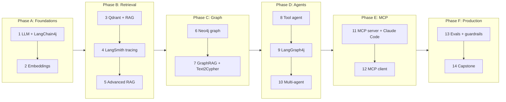

# Roadmap: 14 POCs

Each POC is small, runs on its own, and ends with something you can **see** working.
For every POC: **Goal**, the **concepts** you learn, what you **build**, what to **observe**,
how to **break it** on purpose, when it's **done**, and the **architect artifact** you produce
(the FDE / Solution Architect habit).

Why this order: each POC uses the previous one. Tracing (POC 4) comes **before** advanced RAG and
agents, so that from then on you can *see* every retrieval and every agent step instead of guessing.

---

## Phase A: Foundations

### POC 1: Talk to an LLM with LangChain4j
- **Goal:** call a local model from Java and control its output.
- **Concepts:** LLM, tokens and context window, system vs user messages, temperature, streaming,
  **AI Services** (an interface that LangChain4j implements for you), **structured output**
  (JSON into a Java record), **chat memory**.
- **Build:** Maven skeleton (`tutor` module), config (model names from env vars),
  `ConceptExplainer` AI Service returning a `ConceptCard(title, oneLiner, analogy, keyTerms)` record,
  and a chat with a 10-message memory window.
- **Observe:** the same question at temperature 0 vs 0.8; token counts; time to first token with
  streaming vs without; what memory does to a follow-up question ("give me an example of *it*").
- **Break it:** ask about something the model can't know (a made-up framework). It will probably
  answer confidently. That's the reason RAG exists.
- **Done when:** a `ConceptCard` for "embeddings" parses into a Java record, and a follow-up question
  uses memory.
- **Architect artifact:** a table "qwen2.5:3b vs 7b": latency, tokens/s, quality of 3 answers.

### POC 2: Embeddings and similarity
- **Goal:** understand meaning as numbers.
- **Concepts:** embedding vector, dimensions (768), cosine similarity, semantic vs keyword match,
  in-memory vector store, nearest neighbour search.
- **Build:** embed ~15 sentences, print a similarity matrix, search with LangChain4j's
  `InMemoryEmbeddingStore`.
- **Observe:** "AI agent" vs "autonomous assistant" (no shared words, high score);
  "Java" the language vs "Java" the island; scores are relative, not percentages.
- **Break it:** compare the same text with and without nomic's `search_query:` / `search_document:`
  prefixes.
- **Done when:** you can explain why a threshold of 0.5 means nothing on its own.
- **Architect artifact:** a one-page note "how to choose an embedding model" (dimensions, language,
  cost, re-embedding on change).

---

## Phase B: Retrieval

### POC 3: Vector database (Qdrant) and basic RAG
- **Goal:** answer questions from *your* notes, with citations.
- **Concepts:** ingestion pipeline, **chunking** (by section vs fixed size), payload/metadata,
  idempotent upsert, top-k retrieval, prompt augmentation, grounding, citations.
- **Build:** write the ~25 concept notes (Claude Code drafts them, you review); `NoteLoader`
  (front matter + body); section chunker; ingest into Qdrant collection `ai_concepts`;
  `RagService`: retrieve top-k → prompt with numbered context → answer citing `[concept-id]`.
  Do it twice: by hand (to see every step) and with LangChain4j's `RetrievalAugmentor`.
- **Observe:** the same question with and without RAG; which chunks were retrieved and their scores.
- **Break it:** ask something not in the notes. Does it refuse, or invent?
- **Done when:** 5 test questions are answered with correct citations; re-running ingest doesn't
  create duplicates.
- **Architect artifact:** ADR "chunking strategy" with measured results.

### POC 4: Observability with LangSmith
- **Goal:** see inside every LLM call and retrieval.
- **Concepts:** traces, spans, parent/child runs, run types (llm, retriever, chain, tool),
  OpenTelemetry, GenAI semantic conventions, token and latency accounting.
- **Build:** a `TracingChatModelListener` (LangChain4j hook) plus spans around retrieval, exported
  with OpenTelemetry to LangSmith's OTLP endpoint. With no API key, traces go to a local JSON file,
  so the POC still works offline.
- **Observe:** in LangSmith, the POC 3 RAG flow as a tree: retrieval → prompt → LLM, with tokens and
  timings.
- **Break it:** stop Ollama mid-run: what does the trace show?
- **Done when:** one RAG question shows up in LangSmith as one trace with nested spans.
- **Architect artifact:** "what to monitor in production for an LLM app" (latency p95, tokens,
  error rate, empty retrievals).

### POC 5: Advanced RAG
- **Goal:** make retrieval measurably better.
- **Concepts:** BM25 keyword search, **hybrid search**, **Reciprocal Rank Fusion (RRF)**,
  **query rewriting**, metadata filtering, **reranking** (LLM as reranker), hit@k and MRR.
- **Build:** a BM25 index written in Java (~60 lines, so you understand it); hybrid retriever with
  RRF; query rewriter (LLM turns "that graph thing with LLMs" into searchable terms); a retrieval
  eval over a 20-question golden set.
- **Observe:** a table: vector vs BM25 vs hybrid vs hybrid+rerank on hit@1, hit@3, MRR, latency.
- **Break it:** exact-term queries ("RRF", "BM25") on vector-only search.
- **Done when:** the comparison table exists and you can say which method you'd ship, and why.
- **Architect artifact:** a retrieval trade-off table (quality vs latency vs complexity).

---

## Phase C: Graph

### POC 6: Knowledge graph in Neo4j (embedded, no Docker)
- **Goal:** model how concepts connect and query that structure.
- **Concepts:** property graph (nodes, relationships, properties), Cypher, `MERGE` for idempotent
  loads, variable-length paths (`REQUIRES*`), shortest path, topological ordering, graph vs relational.
- **Build:** `graph-server` module: Neo4j embedded with Bolt on port 7687 (behaves like a real
  server); load concepts and edges from front matter; queries: prerequisites, learning path,
  neighbours, "concepts with no prerequisites", "most connected concept"; print the learning path as
  a Mermaid diagram.
- **Observe:** the learning path for `graph-rag`; optionally browse the graph in Neo4j Browser.
- **Break it:** add a cycle (A requires B, B requires A). What happens to the learning path?
  The cycle check belongs in the loader.
- **Done when:** "What before LangGraph?" is answered by Cypher alone, with no LLM.
- **Architect artifact:** "when to use a graph DB vs a vector DB vs SQL" one-pager.

### POC 7: GraphRAG and Text-to-Cypher
- **Goal:** answer questions that need *connections*, not just similar text.
- **Concepts:** **GraphRAG** (entity linking → graph expansion → combined context), multi-hop
  questions, **Text-to-Cypher**, schema-in-prompt, guardrails on generated queries, LLM-built graphs
  (extracting entities and relations from text) vs curated graphs.
- **Build:** link a question to concepts (vector search over concept summaries); expand 1–2 hops in
  Neo4j; combine graph facts with text chunks; answer. Text-to-Cypher with a read-only guard and an
  error-repair retry. An experiment: let the LLM extract relations from 3 notes and compare with the
  curated edges.
- **Observe:** "How does MCP relate to agents?": vector RAG vs GraphRAG answers side by side.
- **Break it:** ask Text-to-Cypher to "delete all concepts". The guard must block it.
- **Done when:** GraphRAG beats vector RAG on 3 multi-hop questions, and the guard blocks every
  write.
- **Architect artifact:** ADR "GraphRAG: when it's worth the extra complexity".

---

## Phase D: Agents

### POC 8: Your own tool-calling agent
- **Goal:** let the model decide which tools to use.
- **Concepts:** tool calling, tool descriptions as prompts, the ReAct loop (reason → act → observe),
  max iterations, tool errors as data, agent vs workflow.
- **Build:** `@Tool` methods: `searchNotes`, `learningPath`, `relatedConcepts`, `runCypher`
  (guarded); a `TutorAgent` AI Service using them with chat memory.
- **Observe:** in LangSmith, the sequence of tool calls for "Plan how I learn GraphRAG, then explain
  the first step".
- **Break it:** write a vague tool description, and watch the model choose the wrong tool.
- **Done when:** the agent uses 2+ tools in one answer, and every call is visible in the trace.
- **Architect artifact:** "agent or workflow?" decision checklist.

### POC 9: Stateful workflows with LangGraph4j
- **Goal:** control the flow explicitly: routes, loops, pauses.
- **Concepts:** `StateGraph`, state and channels (reducers), nodes, edges, **conditional edges**,
  **corrective RAG** (grade → rewrite → retry), **checkpoints** (memory per thread),
  **human-in-the-loop** (interrupt and resume), graph visualisation.
- **Build:** the tutor graph from [architecture §6.2](architecture.md#62-answering-a-question-target-poc-9):
  router → hybrid / graph / GraphRAG → answer → grounding check → retry once.
  A quiz sub-graph: generate question → **pause** for your typed answer → grade → explain.
- **Observe:** the generated Mermaid diagram of your graph; a trace where the grader forced a retry.
- **Break it:** remove the retry limit, and you get an infinite loop. That's why limits live in code.
- **Done when:** the quiz pauses, resumes from its checkpoint with your answer, and grades it.
- **Architect artifact:** a state diagram plus a failure-mode table (what each node does on error).

### POC 10: Multi-agent with a supervisor
- **Goal:** split work across specialised agents.
- **Concepts:** supervisor pattern, agent hand-offs, specialised prompts and tools per agent,
  shared vs private state, the cost of extra LLM calls.
- **Build:** a supervisor that routes to **Researcher** (retrieval tools), **Planner** (graph
  tools), **Quiz master** and **Critic** (checks citations); built with LangGraph4j.
- **Observe:** count the LLM calls and time per request vs POC 9's single graph.
- **Break it:** give two agents overlapping tools. Who wins?
- **Done when:** "Teach me GraphRAG in 3 steps and test me" involves at least 3 agents.
- **Architect artifact:** ADR "single agent vs multi-agent" with measured cost and latency.

---

## Phase E: MCP

### POC 11: MCP server, used by Claude Code
- **Goal:** publish your tools so *any* AI client can use them. This is where your Claude Pro plan joins.
- **Concepts:** MCP architecture (host, client, server), the three primitives: **tools**,
  **resources**, **prompts**; JSON-RPC; stdio vs Streamable HTTP; tool schemas; server instructions;
  data leaving to a cloud model.
- **Build:** a Java MCP server (official MCP Java SDK, stdio): tools `search_notes`,
  `learning_path`, `related_concepts`, `graph_query` (guarded); resources `concept://{id}`;
  a prompt `study_plan`. Register it with `claude mcp add`.
- **Observe:** in Claude Code, "Using concept-graph, plan my study of GraphRAG". Watch which tools
  Claude calls. Optionally test with MCP Inspector.
- **Break it:** return a huge payload from a tool. What happens to Claude's context?
- **Done when:** Claude Code builds a study plan purely from your tools' outputs, with citations.
- **Architect artifact:** "MCP server design checklist" (naming, schemas, payload size, auth, audit).

### POC 12: MCP client in your own agent
- **Goal:** your LangChain4j agent consumes MCP tools: yours and others'.
- **Concepts:** tool discovery, `McpToolProvider`, local vs remote tools (same to the model,
  different operationally), tool filtering, failure when a server is down.
- **Build:** POC 8's agent gets its tools from the POC 11 server over MCP instead of `@Tool`;
  add a second server (for example the filesystem MCP server, read-only on `knowledge-base/`).
- **Observe:** the same answer as POC 8, now with tools discovered at runtime.
- **Break it:** kill the MCP server mid-conversation.
- **Done when:** the agent works with MCP-only tools and degrades clearly when a server is missing.
- **Architect artifact:** the integration view: which tools are local, which are MCP, and why.

---

## Phase F: Production thinking

### POC 13: Evals, guardrails and semantic cache
- **Goal:** prove quality, block abuse, cut cost.
- **Concepts:** golden sets, retrieval vs answer metrics, **LLM-as-judge** (and its bias),
  regression testing for prompts, **prompt injection** (a "poisoned" note in the knowledge base),
  input/output guardrails, **semantic cache** (embedding-similar questions reuse an answer).
- **Build:** an eval runner (retrieval hit@k, citation correctness, judge score) producing a
  markdown report; a poisoned note test; an input guard; a semantic cache with a similarity threshold.
- **Observe:** the report before and after a prompt change; the cache hit rate on rephrased questions.
- **Break it:** set the cache threshold too low, and it returns wrong answers to different questions.
- **Done when:** one command produces an eval report, and the poisoned note doesn't change answers.
- **Architect artifact:** a production-readiness checklist for an LLM feature.

### POC 14: Capstone: Tutor API and architecture pack
- **Goal:** put it together like you would for a customer.
- **Build:** a small REST API (`/ask`, `/path/{id}`, `/quiz`) over the POC 9 graph; a one-command
  start script; a 10-minute demo script.
- **Architect artifact (the FDE pack):** an architecture diagram, ADR index, cost/latency numbers,
  eval report, risks and mitigations, "how this would run in production" (hosted model, managed
  vector DB, Neo4j Aura, OAuth on MCP, CI evals).
- **Done when:** you can demo it end to end and defend every design decision.

---

## Optional extras (when you want more)

| Extra | What you learn |
|------|----------------|
| Neo4j vector index instead of Qdrant | One database for vectors and graph: compare with POC 7 |
| LangChain4j `agentic` module | Another Java agent style; compare with LangGraph4j |
| LangGraph4j Studio | A visual debugger for your graphs |
| Streamable HTTP MCP transport + OAuth | Remote, multi-user MCP (LoanPilot POC 4 started this) |
| Claude API provider | Swap Ollama for Claude with config only (needs a paid API key) |
| Fine-tuning vs RAG experiment | When to change the model vs change the context |
